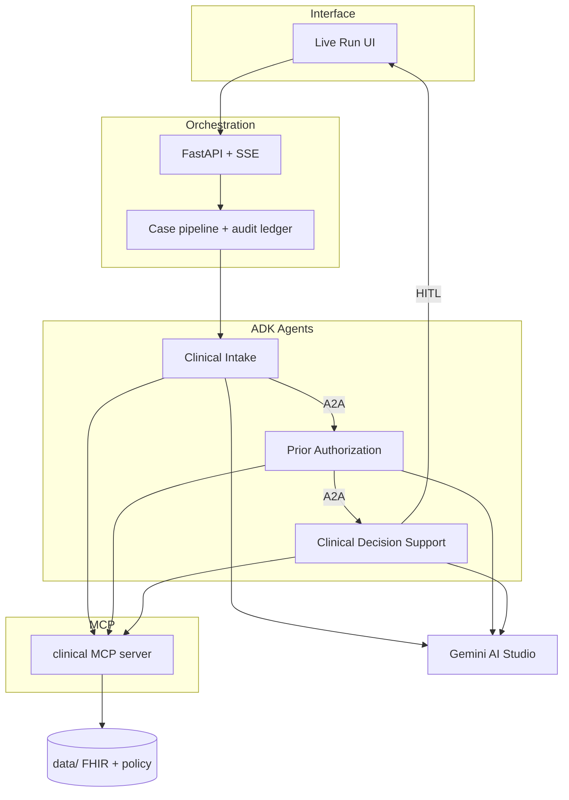

# AgentThree — Prior Authorization

One end-to-end prior authorization scenario (**CPT 72148 · MRI lumbar spine**) using **Google ADK**, **A2A**, **MCP**, and **Gemini**, connected to a Live Run UI.

**Repo:** [nickgulrajani/agentthree-prior-auth](https://github.com/nickgulrajani/agentthree-prior-auth)
**Lab:** [agentthree.ai/solutions/agentic-ai](https://agentthree.ai/solutions/agentic-ai)

> Fictional patients, payer, and policy — **not for clinical use**.

---

## Status

[](https://github.com/nickgulrajani/agentthree-prior-auth/actions/workflows/verify.yml)

**Last verified:** 2026-10-18 · 21 pytest green · suite via [`make verify`](https://github.com/nickgulrajani/agentthree-ai-engineering-portfolio#verify-everything) in the [AI Engineering Portfolio](https://github.com/nickgulrajani/agentthree-ai-engineering-portfolio) monorepo ([CI](https://github.com/nickgulrajani/agentthree-ai-engineering-portfolio/actions/workflows/verify.yml)). This repo also runs pytest, the evaluation gate, and Live Run UI lint/build on push, PR, and a nightly schedule.


## Implementation status

| Area | Status | Notes |
|------|--------|-------|
| ADK agents (intake · prior auth · CDS) | **Implemented (local)** | Google ADK `LlmAgent`s in `agents/` |
| A2A handoffs | **Implemented (local)** | Pipeline `send_a2a()` POSTs JSON-RPC `message/send` to Agent Card servers when `START_A2A=true` (ports 9001–9003); falls back to local envelopes if servers are down |
| MCP clinical tools + fault drills | **Implemented (local)** | FastMCP over demo FHIR / policy; resilience drills arm `set_fault` on the server with real failures + sleeps |
| Live Run UI (React + classic HTML) | **Implemented (local)** | SSE pipeline + human-in-the-loop gate; decision endpoint returns `409` if the case is already sealed |
| Audit ledger | **Implemented (local)** | Case trail for demo runs |
| Gemini reasoning | **Optional live API** | Async `google.genai` client (AI Studio) when `DEMO_MODE=false` + `GOOGLE_API_KEY`; grounding counts `claims` / `cited` / `unsupported` |
| Fixture / offline path | **Implemented** | `DEMO_MODE=true` — $0; MCP + A2A still exercise real code paths |
| Vertex AI / Workspace Gemini | **Not used by default** | Keep `GOOGLE_GENAI_USE_VERTEXAI=FALSE` |
| Cloud Run / GKE deploy | **Not deployed** | Optional future — not required for the demo |

**Simulated vs cloud:** Orchestration, MCP tools, A2A HTTP handoffs, and UI are real local services. Clinical data and payer policy are **synthetic**. LLM calls are either fixture-backed (`DEMO_MODE=true`) or optional **AI Studio** API — not a production Vertex / Cloud Run deployment.

Architecture diagram: below and [docs/architecture.md](docs/architecture.md)

---

## Architecture



Full write-up: [`docs/architecture.md`](docs/architecture.md)

---

## Repository layout

```
agents/                  # Google ADK LlmAgents
  clinical_intake/
  prior_auth/
  clinical_decision_support/
mcp_servers/             # FastMCP tool servers
  clinical/              # FHIR · RxNorm · policy · eligibility · guidelines
agentthree/              # Orchestration backend (pipeline, API, audit, Gemini steps)
web/                     # React Live Run FE (Vite) — watch agents in play
ui/                      # Classic HTML Live Run
data/                    # Demo FHIR patients + AHP-RAD-014 policy
evaluation/              # Synthetic cases + metric scoring
tests/                   # Unit / smoke tests
docs/                    # Architecture and design notes
scripts/run_demo.sh
```

---

## Quick start (free tier)

No Workspace Gemini license required. Use a [Google AI Studio](https://aistudio.google.com/apikey) free API key.

```bash
python3 -m venv .venv
source .venv/bin/activate          # Windows: .venv\Scripts\activate
pip install -r requirements.txt
cp .env.example .env               # set GOOGLE_API_KEY; DEMO_MODE=false for live Gemini

# Terminal 1 — backend (MCP + API)
.venv/bin/python -m agentthree

# Terminal 2 — React FE (agents lighting up live)
cd web && npm install && npm run dev
```

Open **http://127.0.0.1:5173** — one UI with:

| Tab | What you show |
|-----|----------------|
| **Overview** | Architecture SVG (ADK · A2A · MCP · HITL · audit) |
| **Live run** | Agents lighting up + MCP / A2A inspector |
| **Engineering** | Capability cards |
| **Build status** | What’s built vs deferred |

Classic HTML remains at **http://127.0.0.1:8000/classic**.

Optional: `cd web && npm run build` then restart the backend so `/` serves the React bundle.

| Mode | Cost |
|------|------|
| Local MCP / API / UI | $0 |
| Gemini AI Studio Free tier | $0 within rate limits |
| `DEMO_MODE=true` | $0 (fixtures; MCP + A2A still real) |

Keep `GOOGLE_GENAI_USE_VERTEXAI=FALSE` to stay off Vertex billing.

---

## Scenario

Happy path: Jordan Rivera · CPT `72148` · ICD-10 `M54.16` · 6+ weeks PT · neurologic findings → recommend approval → human gate.

Fault injection: MCP timeout / eligibility outage / missing policy via MCP `set_fault`; CDS `grounding_fail` injects an uncited claim before the citation filter, blocks it, then regenerates clean.

---

## Evaluation results (published)

Deterministic offline scorer (`evaluation/run_eval.py`) — no Gemini required. Baseline committed in [`evaluation/published_results.json`](evaluation/published_results.json).

| Case ID | Agent task (expected outcome) | Actual | Pass |
|---------|-------------------------------|--------|------|
| `meets-criteria` | Recommend approval after 6+ weeks PT + neuro findings | `meets` | ✓ |
| `missing-documentation` | Pend — incomplete conservative care | `pend` | ✓ |
| `red-flag-urgent` | Escalate — cauda equina red flags | `urgent` | ✓ |
| `meets-pt-words` | Recommend approval (alternate meets path) | `meets` | ✓ |
| `pend-prior-imaging` | Pend — prior lumbar MRI in window | `pend` | ✓ |

| Metric | Result |
|--------|--------|
| **Task / outcome accuracy** | **5 / 5 (100%)** |
| Golden cases | 5 synthetic CPT `72148` scenarios |
| CDS grounding on meets path | Citations present; `unsupported = 0` |
| Pytest (domain + MCP + eval + grounding) | 21 passed |

Reproduce:

```bash
.venv/bin/python -m evaluation.run_eval   # writes evaluation/last_results.json
.venv/bin/python -m pytest tests/ -q
```

---

## Develop next

| Area | Folder | Next increments |
|------|--------|-----------------|
| Agents | `agents/` | Stronger structured output schemas |
| MCP | `mcp_servers/` | Split FHIR / policy / eligibility into separate servers |
| Evaluation | `evaluation/` | Wire UI Evaluation tab to `published_results.json` |
| Tests | `tests/` | Broader live-pipeline integration (with MCP + optional A2A up) |
| Deploy | _(future)_ | Cloud Run / GKE — optional, not required for the demo |

### Reproducible tests

```bash
python3 -m venv .venv
source .venv/bin/activate
pip install -r requirements.txt
cp -n .env.example .env   # DEMO_MODE=true for offline path

.venv/bin/python -m pytest tests/ -q
.venv/bin/python -m evaluation.run_eval
```

Expected: pytest green (domain, MCP contract, evaluation); `evaluation.run_eval` reports **100%** outcome accuracy on the five golden cases and writes `evaluation/last_results.json`. Committed baseline: [`evaluation/published_results.json`](evaluation/published_results.json). For the full Live Run UI, follow Quick start above (backend + `web/` Vite app).
